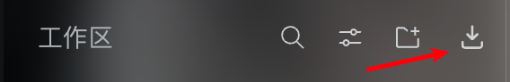
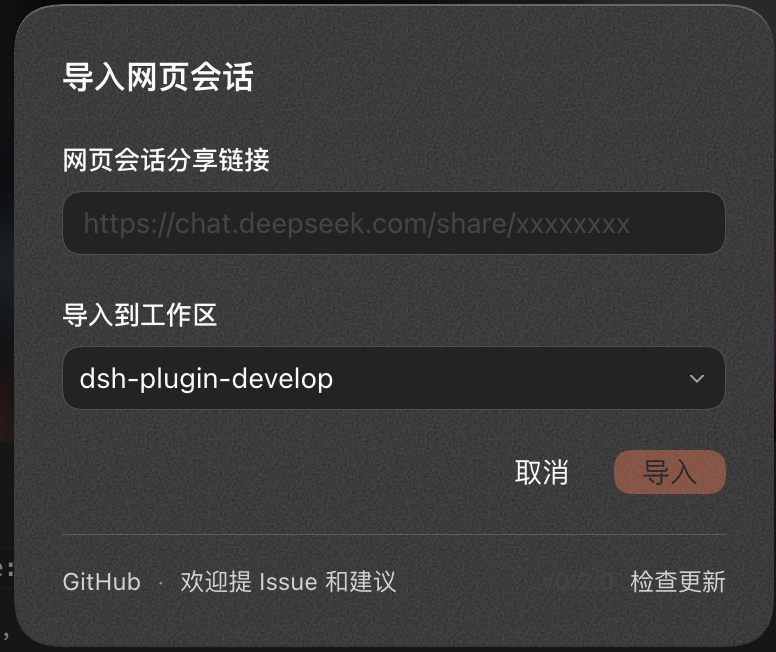

# dsh-webseek

**English** | [中文](#中文)

Turn a **DeepSeek web share link** into a real session inside DSH.

## English

### What it does

In DSH Web, clicking **Share** on a chat gives you a public link (`https://chat.deepseek.com/share/<id>`). This plugin adds an import icon to the left sidebar: paste the link, pick a target workspace, and you get a new session with the same title — the full conversation from that share, ready to keep chatting in.

### Screenshots

The import entry in the sidebar, and the import dialog with its footer:





### Install

Requires DSH `>=0.2.0-rc.2 <0.3.0` and Node `>=22`.

```bash
dsh plugin --profile <your-profile> add dsh-webseek
```

### Usage

1. Click the **import** icon on the left sidebar (in the collapsed 56px rail it sits in the plugin-icon row above the gear).
2. Paste the share link (`https://chat.deepseek.com/share/…`, or just the share id).
3. Pick the target workspace → **Import**.
4. The session appears in the sidebar right away; click **Open session** in the dialog to jump to it.

The imported session is a cold session: the title comes from the share, and the body replays the mainline you see on the web page (user turns plus model answers, with the model's thinking kept as a `[思考]` block before each answer). Importing the same share twice does not create a duplicate.

### Interface & update check

The dialog follows your light/dark theme and skin plugins automatically, with no hard-coded colors. Its footer holds a link to this project on GitHub, an entry to file issues or suggestions, the current version, and a **Check for updates** button that queries npm and shows "Up to date" or "New version vX.Y.Z".

### Compatibility

- Runs on the DSH **web** client.
- Imported sessions cannot be continued in-place under an ACP backend (such as codebuddy-code): ACP only accepts sessions it created, and refuses a message to an imported history (`ACP_BACKEND_NEW_SESSION_REQUIRED`). Native model backends (OpenAI-compatible) have no such limit and treat the history as context.

### Known limitations

- `api/v0/share/content` is the web app's internal endpoint; it may break when DeepSeek changes. Failures are reported in the dialog.
- The share title may just be the web default "Shared Conversation"; the plugin copies it as-is.
- The session shows up immediately; if it ever doesn't, refresh the page.

### License

MIT

## 中文

把 **DeepSeek 网页版的分享链接**变成 DSH 里一个真实的会话。

### 简介

在 DSH 网页版点「分享」会得到一个公开链接（`https://chat.deepseek.com/share/<id>`）。本插件在左侧栏放一个导入图标，填两样东西——分享链接、目标工作区——就会得到一个同名的新会话，内容是那份分享的完整对话，可以直接接着聊。

### 界面截图

左栏的导入入口，以及带页脚的导入弹框：


### 安装

需要 DSH `>=0.2.0-rc.2 <0.3.0`、Node `>=22`。

```bash
dsh plugin --profile <你的 profile> add dsh-webseek
```

### 用法

1. 点左侧栏的**导入**图标（折叠成 56px 导轨时，图标落在齿轮上方那行插件图标里）。
2. 粘贴分享链接（`https://chat.deepseek.com/share/…` 或直接是分享 id）。
3. 选目标工作区 → **导入**。
4. 左栏立刻出现同名会话；弹框里点「打开会话」直接跳过去。

导入的会话是「冷会话」：标题取网页上的标题，正文按网页上看到的主线回放（用户轮次 + 模型回答，模型的思考过程以 `[思考]` 段落保留在回答前面）。同一份分享重复导入不会重复建会话。

### 界面与检查更新

弹框跟随你的深浅色主题与皮肤插件自动切换，没有一处硬编码颜色。底部一行页脚：本项目 GitHub 链接、反馈 Issue 的入口、当前版本号，以及**检查更新**——点一下向 npm 查询最新发布版本，显示「已是最新」或「有新版本 vX.Y.Z」。

### 兼容

- 运行在 DSH **web** 客户端。
- 导入的会话在当前 ACP 后端（codebuddy-code 这类）下不能就地续聊：ACP 只认自己创建的会话，给外来历史的会话发消息会被拒绝（`ACP_BACKEND_NEW_SESSION_REQUIRED`）。原生模型后端（OpenAI 兼容那类）没有这个限制，历史会作为上下文发出去。

### 已知限制

- `api/v0/share/content` 是网页版的内部接口，DeepSeek 改版即可能失效；失败时弹框会给出提示。
- 分享标题可能就是网页默认的「Shared Conversation」——插件照搬网页标题。
- 导入的会话会立刻出现在左栏；万一没出现，刷新一下页面即可。

### 许可证

MIT
